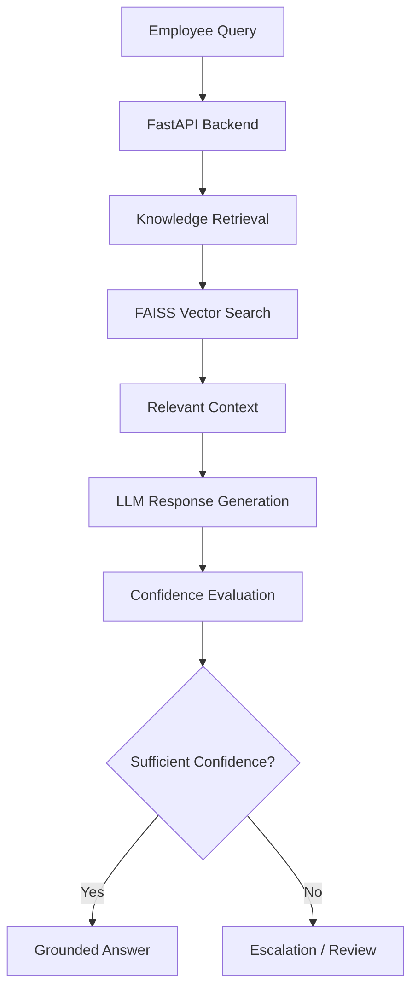

<div align="center">

# HR365
### Intelligent HR Management, Powered by AI.

**A modern HR platform combining AI-powered knowledge retrieval, confidence-aware responses, and employee self-service workflows.**

<br/>


</div>

---

## ✨ Overview

**HR365** is an AI-powered HR management platform designed to make workplace information more accessible and everyday HR workflows more efficient.

It combines a custom **Retrieval-Augmented Generation (RAG)** pipeline with a modern web interface and backend services, allowing employees to find policy information, interact with HR knowledge, and access essential self-service features.

Rather than relying entirely on an LLM's general knowledge, HR365 retrieves relevant information from a knowledge base and uses it to generate grounded, context-aware answers.

## 🚀 Key Features

| Feature | Description |
|---|---|
| 🤖 **AI HR Assistant** | Ask questions about company policies, FAQs, and HR documentation. |
| 🧠 **Custom RAG Pipeline** | Retrieves relevant knowledge before generating responses. |
| 🔎 **Semantic Search** | Uses vector embeddings and FAISS for similarity-based retrieval. |
| 🎯 **Confidence Engine** | Evaluates answer confidence and supports escalation when confidence is insufficient. |
| 📚 **Citation-Aware Responses** | Connects answers to retrieved knowledge and supporting context. |
| 👤 **Employee Self-Service** | Access supported HR workflows such as attendance, leave requests, and HR queries. |
| 🔐 **Authentication & Access Control** | Integrates Supabase-backed data services and authentication-related controls. |
| ⚡ **Modern Web Interface** | Responsive frontend built with Next.js, TypeScript, and Tailwind CSS. |

## 🧠 How It Works



The RAG workflow retrieves relevant context from the knowledge base, passes it to the language model, and evaluates the resulting answer before returning it to the user.

## 🛠️ Tech Stack

**Frontend**
- Next.js
- React
- TypeScript
- Tailwind CSS
- Framer Motion
- Lenis

**Backend**
- Python
- FastAPI
- Pydantic
- Uvicorn

**AI & Retrieval**
- Retrieval-Augmented Generation (RAG)
- FAISS
- Transformer-based models and embeddings
- Groq API for LLM inference
- Confidence evaluation and citation handling

**Database & Infrastructure**
- Supabase
- PostgreSQL
- Environment-based configuration
- HTTPX and Requests

## 📁 Project Structure

```text
HR365/
├── backend/
│   ├── app/
│   ├── requirements.txt
│   └── ...
├── frontend/
│   ├── app/
│   ├── public/
│   ├── package.json
│   └── ...
├── .gitignore
└── README.md
```

*The exact contents may evolve as the project develops.*

## ⚙️ Getting Started

### Prerequisites

- Python 3.11+
- Node.js and npm
- A Supabase project
- A Groq API key

### 1. Clone the Repository

```bash
git clone https://github.com/ArshZaidi/HR365.git
cd HR365
```

### 2. Set Up the Backend

```bash
cd backend
python -m venv .venv
```

Activate the virtual environment:

**Windows**
```bash
.venv\Scripts\activate
```

**macOS / Linux**
```bash
source .venv/bin/activate
```

Install dependencies:

```bash
pip install -r requirements.txt
```

Configure the required environment variables using your local environment configuration.

Typical variables include:

```env
SUPABASE_URL=your_supabase_url
SUPABASE_KEY=your_supabase_key
GROQ_API_KEY=your_groq_api_key
HR365_ENCRYPTION_KEY=your_encryption_key
CORS_ORIGINS=http://localhost:3000
```

Use the variable names expected by your current backend configuration. Keep real credentials in local environment files and never commit secrets.

Start the API server from the appropriate backend directory:

```bash
uvicorn app.main:app --reload
```

### 3. Set Up the Frontend

Open a new terminal:

```bash
cd frontend
npm install
npm run dev
```

Open **http://localhost:3000** in your browser.

> Make sure the backend, environment variables, and Supabase configuration are set up correctly before testing integrated features.

## 🔒 Security & Reliability

HR365 is designed with attention to:

- Environment-based secret management
- Authentication and access-control boundaries
- Confidence-aware AI responses
- Escalation for answers that require additional review
- Separation of frontend, backend, and data services

Security controls must be configured and verified in the deployed environment; their presence in the architecture alone does not guarantee production readiness.

## 🗺️ Roadmap

- [ ] Expand the HR knowledge base and document ingestion pipeline
- [ ] Improve retrieval quality and answer evaluation
- [ ] Strengthen citations and low-confidence escalation
- [ ] Expand employee self-service workflows
- [ ] Enhance role-based access and administrative controls
- [ ] Add comprehensive automated testing and deployment workflows

## 🎯 Vision

The goal of HR365 is simple: **make HR information easier to find, HR workflows easier to complete, and AI-generated answers more accountable.**

By combining retrieval, language models, confidence evaluation, and employee-focused workflows, HR365 explores how AI can make everyday HR operations more accessible and reliable.

---

<div align="center">

**Built with Python, FastAPI, Next.js, and AI.**

⭐ If you find this project interesting, consider giving the repository a star!

[**View Repository →**](https://github.com/ArshZaidi/HR365)

</div>
